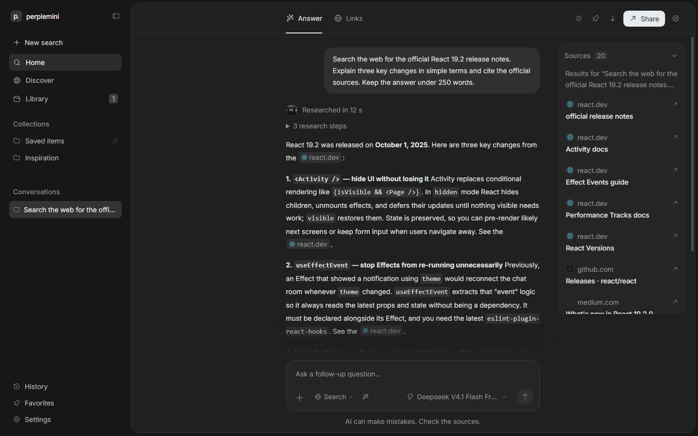

# Perplemini

An open-source answer engine powered by the CLI tools you already use: **OpenCode, Codex and Claude Code**. Ask questions, let the model research the web, and read a streamed answer with linked sources.

Built with React, Vite and Express. Independent project, not affiliated with Perplexity.

## Demo

[](https://github.com/Galavic/perplemini/blob/main/docs/demo.mp4)

[Watch the video](docs/demo.mp4). Recorded in the app using **DeepSeek V4.1 Flash Free through OpenCode**, with real web research, streaming, citations and the sources panel. No mocked model responses or search results.

## Features

- AI-directed web research: the model chooses queries, reads pages and compares sources.
- Streamed Markdown answers with citations and a separate sources panel with site favicons.
- Searchable CLI and model picker, with a saved selection for each provider.
- Search, Academic and Write modes, plus optional Deep research.
- Up to eight image attachments, with previews, clipboard paste and drag and drop.
- Text file attachments, follow-up questions, local history, saved conversations and Markdown export.
- Light and dark themes, responsive layouts, custom scrollbars and keyboard navigation.
- An animated robot mascot and word-by-word blur reveals that respect reduced-motion preferences.

## Quick start

Requires **Node.js 22.12+** and at least one supported CLI installed on the machine running the server.

```sh
npm install
```

Copy `.env.example` to `.env`:

```sh
# macOS / Linux
cp .env.example .env
```

```powershell
# Windows
Copy-Item .env.example .env
```

Start the app:

```sh
npm run dev
```

Open **http://localhost:3000**. The server binds to your own computer by default.

## Connect a CLI

Choose an installed CLI and model in the model picker below the input. Settings shows installation status and login commands. You only need one CLI.

### OpenCode

Install [OpenCode](https://dev.opencode.ai/v2/docs/cli/commands/) and configure the provider you want to use. Perplemini does not require a separate OpenCode CLI login. Model access and authentication depend on the provider configured in OpenCode.

The demo uses this model, when available in the CLI catalog:

```dotenv
CLI_PROVIDER=opencode
CLI_OPENCODE_MODEL=opencode/deepseek-v4.1-flash-free
```

You can also select it in the app. Free model availability and limits may change. Text generation access does not guarantee web search access: OpenCode may need its own [web search configuration](https://dev.opencode.ai/v2/docs/websearch/).

### Codex

Install [Codex CLI](https://developers.openai.com/codex/cli/) and connect your account:

```sh
codex login
```

### Claude Code

Install [Claude Code](https://code.claude.com/docs/en/quickstart) and connect your account:

```sh
claude auth login
```

Perplemini uses the authentication managed by each CLI. It does not ask for API keys in the browser. CLI installation and account access are separate checks; authentication, model access and quota errors are shown in the conversation.

### Configuration

| Variable | Purpose |
| --- | --- |
| `PORT` | Server port. Default: `3000`. |
| `HOST` | Bind address. Default: `127.0.0.1`. |
| `CLI_PROVIDER` | Default CLI: `codex`, `claude` or `opencode`. |
| `CLI_CODEX_PATH`, `CLI_CLAUDE_PATH`, `CLI_OPENCODE_PATH` | Optional executable or script path when the CLI is not on PATH. Shell commands are not accepted. |
| `CLI_CODEX_MODEL`, `CLI_CLAUDE_MODEL`, `CLI_OPENCODE_MODEL` | Optional default model for each CLI. An empty value uses the CLI default. |
| `CLI_TIMEOUT_MS` | Request timeout. Default: `180000`; maximum: `900000`. |

Restart the server after changing `.env`. Model choices made in the app override the corresponding default for that request. Catalogs are cached for one minute; a listed model is not a guarantee of account access.

## How research works

Perplemini sends the conversation context to the selected CLI. The AI decides whether to search, which queries to issue, which pages to read and when enough evidence is available. Greetings and simple conversation can be answered directly. The backend does not run a predefined search or substitute a fixed source provider.

**Academic** asks for original scientific publications and a distinction between peer-reviewed work and preprints. **Deep research** asks for complementary searches, source reading and comparison. **Write** disables web research.

Research activity comes from public CLI tool events. Sources arrive progressively, and Markdown citations link to the source panel. A model citation is not an independent verification of its claims. Private reasoning and shell output are not forwarded to the browser.

### Native CLI transports

- **Codex:** the installed `app-server --listen stdio://` CLI, using JSON-RPC and native answer deltas. Threads are ephemeral and read-only. Shell tools, hooks, extra agents and configured MCP servers are disabled for the request. Native web search is live in research modes.
- **Claude Code:** print mode with `stream-json` output and partial messages. Research modes allow `WebSearch` and `WebFetch`; Write mode disables tools. External MCP servers, hooks and persistent sessions are disabled.
- **OpenCode:** the installed `serve` CLI on a private loopback port with a random password. Perplemini creates a native session and reads its SSE events. Native agent and provider configuration are retained. Web research tools are allowed in research modes; other permission requests are rejected. Both V1 and V2 transports are supported.

Each request runs in its own temporary directory. Prompts travel through stdin or the local CLI protocol, not shell arguments. Stop, disconnection and timeout cancel the CLI process tree. Temporary working directories are removed afterward; a CLI may retain its own session data separately.

## Attachments and streaming

Attach PNG, JPG, WebP or GIF images using **+**, clipboard paste or drag and drop. Limits: **8 attachments**, **5 MB per image**, **20 MB of images per message**. Image understanding requires a vision-capable model. Models are not switched automatically.

TXT, MD, CSV, JSON and LOG text files are supported, with a combined 60 KB text limit. PDF files are not supported. Original images are sent for the current turn; the browser history stores thumbnails rather than full image files.

Answers stream as the CLI emits text. The UI renders Markdown and citations, animates newly received words and follows the response until you scroll up. Stop preserves the partial response. `Enter` sends, `Shift+Enter` inserts a line and `Ctrl/Cmd+K` focuses the input.

## Production and tests

```sh
npm run build
npm start
```

```sh
npm test
npx playwright install chromium
npm run test:e2e
```

Unit and integration tests use fixture CLI processes to check protocols, attachments, errors, cancellation and citations without consuming real model accounts. Browser tests cover conversation flows, streaming, responsive layouts and UI behavior. The demo video is a separate live run.

### Docker

```sh
docker compose up -d --build
# If using Codex or Claude Code inside the container:
docker compose exec app codex login --device-auth
docker compose exec app claude auth login
```

The image installs the three CLIs. Container volumes hold their own configuration and authentication; host CLI logins are not automatically shared. OpenCode uses its configured provider. Docker configuration is included, but has not been validated on the development machine.

## Privacy and deployment

History is stored in browser `localStorage`, without an account or synchronization. Questions, context and attachments are sent to the selected CLI and its configured remote provider. Web tools process search queries and consulted pages. CLI providers may apply their own storage policies, telemetry, billing and usage limits.

Favicons are requested from source sites, with a Google favicon service fallback. Perplemini does not add application analytics or read CLI credential files.

This is a personal, local application. It does not include multi-user authentication, encrypted history, billing, distributed rate limiting or user isolation. Before making it available over the Internet, add authentication, HTTPS and appropriate access controls. CLI permission settings are not an operating-system sandbox against a malicious CLI or plugin.

## Project layout

```text
src/        React interface, styles, mascot and streaming presentation
server/     Express API, CLI discovery, native transports and research events
tests/      Unit and integration tests with CLI fixtures
e2e/        Playwright browser tests
docs/       Demo video and preview image
scripts/    Optional Central Icons import and installation helpers
```

## License and third-party assets

Perplemini application code is licensed under the **[MIT License](LICENSE)**.

Third-party assets retain their original licenses. In particular, the Central Icons SVGs are covered by the collection terms, not the application MIT license. See [THIRD_PARTY_NOTICES.md](THIRD_PARTY_NOTICES.md) and the [asset provenance](src/assets/central-icons/README.md). Optional installation of the complete Central Icons package requires a valid license key; the key is never included in client code or this repository.

The mascot uses [robot-heads](https://github.com/fayazara/robot-heads), the custom scrollbars use [OverlayScrollbars](https://github.com/KingSora/OverlayScrollbars), and the interface uses [Inter](https://github.com/rsms/inter).
